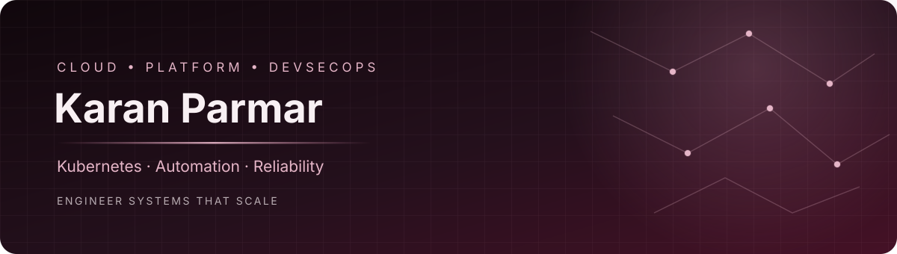

 

### Cloud Infrastructure · Kubernetes · Platform Engineering · DevSecOps

**Designing reliable platforms. Automating the complex. Securing delivery.**

---

## 👋 About Me

I'm **Karan Parmar**, a Cloud and DevSecOps Engineer with **5.5+ years of experience** building, automating, securing, and operating cloud infrastructure and delivery platforms.

My work focuses on cloud engineering, Kubernetes, infrastructure automation, CI/CD, GitOps, DevSecOps, observability, and production reliability. I enjoy transforming repetitive operational tasks into dependable automation, improving software delivery workflows, and making infrastructure easier to manage, secure, and maintain.

I have hands-on experience across **Oracle Cloud Infrastructure (OCI), Amazon Web Services (AWS), and Google Cloud Platform (GCP)**. My engineering approach emphasizes infrastructure as code, secure delivery pipelines, actionable monitoring, systematic troubleshooting, and continuous improvement.

I believe good platform engineering should make the secure and reliable path the easiest path for developers.

## 🧭 Engineering Focus

| Domain | Expertise |
|---|---|
| ☁️ Cloud Infrastructure | OCI, AWS, GCP, compute, storage, IAM, cloud networking, routing, and security controls |
| ☸️ Kubernetes & Containers | Oracle Kubernetes Engine (OKE), Google Kubernetes Engine (GKE), Docker, Helm, deployments, and troubleshooting |
| 🏗️ Infrastructure as Code | Terraform, version-controlled infrastructure, repeatable provisioning, and configuration management |
| 🔄 CI/CD & GitOps | GitHub Actions, Jenkins, GitLab CI/CD, Argo CD, Helm, and automated release workflows |
| 🔐 DevSecOps | SonarQube, OWASP ZAP, Checkov, tfsec, Trivy, and security testing integrated into delivery pipelines |
| 📊 Observability & Reliability | Prometheus, Grafana, Alertmanager, Nagios, ELK, metrics, dashboards, and alerting |
| 🐍 Automation & Scripting | Python, Bash, PowerShell, and Groovy |
| 🗄️ Database & Enterprise Systems | PostgreSQL high availability and disaster recovery, database release automation, and Oracle E-Business Suite operations |

## 🛠️ Technology Stack

### Cloud Platforms

### Kubernetes & Infrastructure

### CI/CD & GitOps

### DevSecOps & Security

- Static Application Security Testing (SAST)
- Dynamic Application Security Testing (DAST)
- Infrastructure-as-Code security scanning
- Container image vulnerability scanning
- IAM, access controls, and secure CI/CD practices

### Monitoring & Observability

- Prometheus metrics collection and Pushgateway
- Grafana dashboards and infrastructure visibility
- Alertmanager alerting workflows
- Nagios monitoring
- ELK-based logging and troubleshooting
- Production health monitoring and operational diagnostics

### Programming & Systems

**Languages and scripting:** Python, Bash, PowerShell, Groovy

**Systems and tools:** Linux, Git, PostgreSQL, Oracle Database

---

## ⚙️ Selected Engineering Work

### 🚀 Ephemeral CI/CD Runner Automation

Built dynamic, ephemeral GitHub Actions self-hosted runners using Docker and Python. Runners are provisioned on demand and removed after jobs, reducing dependence on persistent runner capacity.

### ☁️ Cloud Infrastructure & Kubernetes

Designed and managed OCI infrastructure components, including compute, networking, storage, IAM, subnets, routing, and workload security controls. Worked with Kubernetes, Terraform, Docker, and Helm-based delivery.

### 🔄 Deployment & Release Automation

Automated application deployments using Ansible and moved database release activities into version-controlled GitHub Actions workflows. Worked across GitHub Actions, Jenkins, and GitLab CI/CD tooling.

### 📊 Monitoring & Operational Visibility

Worked with Prometheus, Grafana, Alertmanager, Nagios, and Prometheus Pushgateway to improve infrastructure visibility, alerting, and production troubleshooting.

### ⏱️ Enterprise Automation

Automated Oracle E-Business Suite cloning workflows using Python and Bash, reducing execution time from approximately **15 hours to 5.5 hours**.

### 🗄️ Database Reliability

Contributed to PostgreSQL high-availability and disaster-recovery architecture, alongside database operations and release automation.

---

## 🔐 My Engineering Principles

- **Automation first:** Reduce repetitive manual tasks and improve operational consistency.
- **Infrastructure as code:** Make infrastructure changes reviewable, repeatable, and maintainable.
- **Security by design:** Integrate security checks into the software delivery lifecycle.
- **Reliability through observability:** Use meaningful metrics, dashboards, and actionable alerts.
- **Least privilege:** Apply appropriate access controls and minimize credential exposure.
- **Continuous improvement:** Learn from operational issues and improve processes, tooling, and documentation.

## 📜 Certifications

- **AWS Certified Solutions Architect – Associate**
- Oracle Cloud Infrastructure certifications

## 🌱 Areas of Interest

- Platform engineering and internal developer platforms
- Kubernetes automation and cloud-native infrastructure
- Advanced Terraform and GitOps workflows
- DevSecOps and software supply-chain security
- Site Reliability Engineering (SRE) and observability
- Developer productivity and self-service automation
- Practical open-source infrastructure tools

## 🤝 Let's Connect

I'm interested in connecting with cloud engineers, DevOps professionals, platform engineers, SREs, and open-source contributors who enjoy solving real engineering problems.

- 📍 **Location:** India
- 📧 **Email:** [karanbparmarp1@gmail.com](mailto:karanbparmarp1@gmail.com)
- 💼 **LinkedIn:** [karanp-devops](https://www.linkedin.com/in/karanp-devops)
- 🐙 **GitHub:** [@kpstack](https://github.com/kpstack)

**Build thoughtfully. Automate relentlessly. Operate reliably.**

